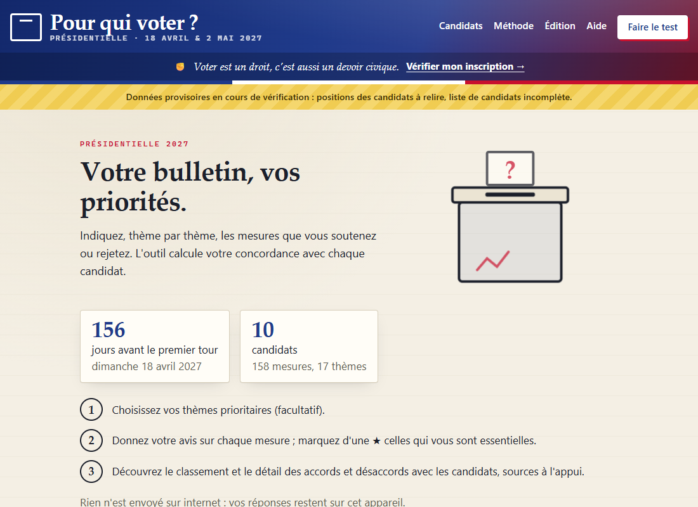
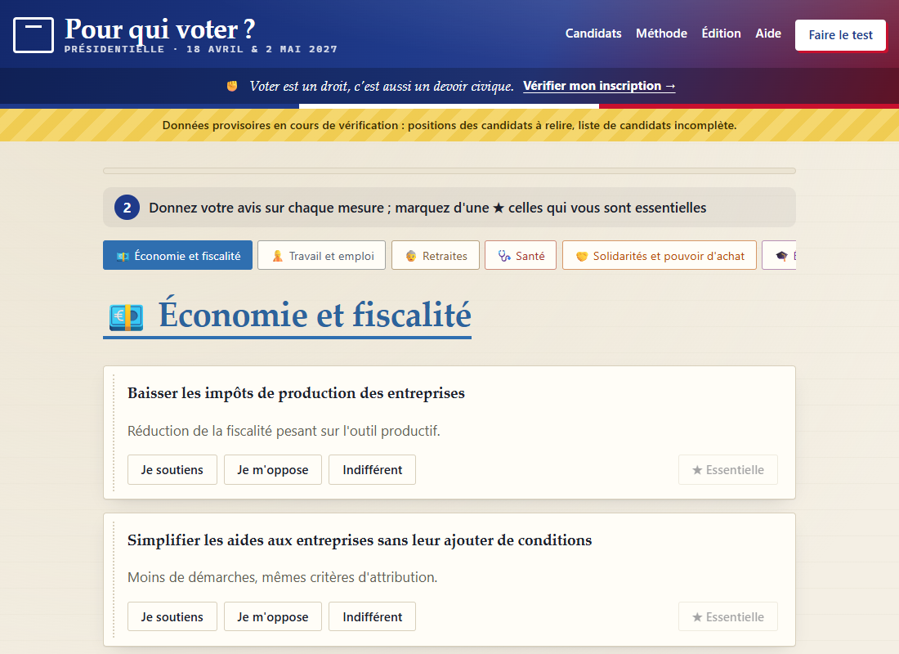
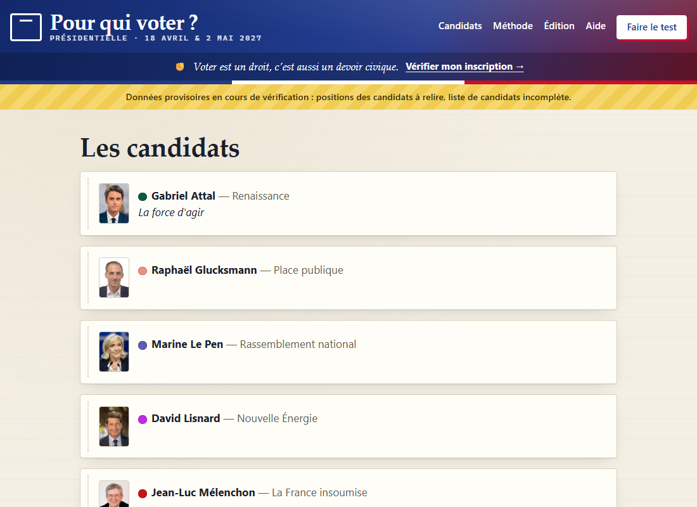
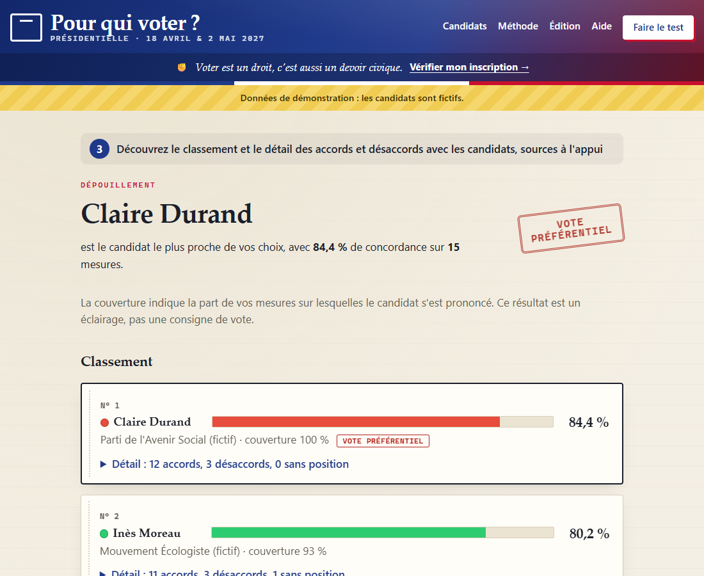
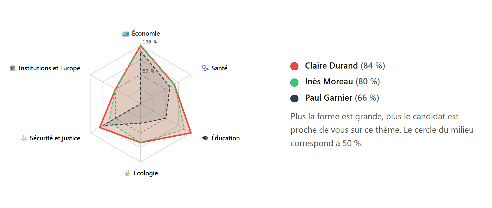
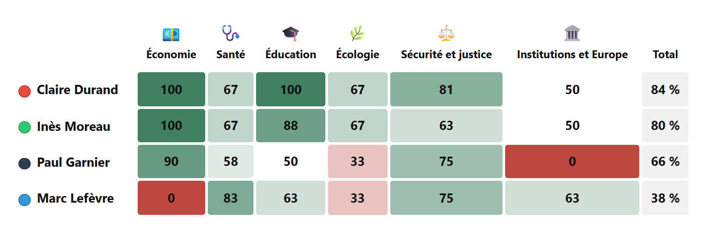

# Pour qui voter ? — Présidentielle 2027

**Pour qui voter ?** est un outil d'aide au vote gratuit, neutre et **hors ligne** pour l'élection présidentielle française de 2027. Il compare vos avis sur des mesures concrètes aux programmes des candidats et explique le résultat, sources à l'appui.

> Cette page s'adresse aux développeurs et aux contributeurs.
> *English version: [README.md](README.md).*



| Questionnaire | Candidats |
|---|---|
|  |  |

*Captures du pack de test (13 novembre 2026).*

## Fonctionnement

1. **Choisissez vos thèmes prioritaires** (facultatif) : les mesures de ces thèmes comptent double.
2. **Donnez votre avis sur chaque mesure** (je soutiens / je m'oppose / indifférent) et marquez d'une ★ celles qui vous sont essentielles (elles comptent triple).
3. **Découvrez le classement** des candidats, avec le détail des accords et désaccords, chacun appuyé d'un lien vers la source (d'abord le site de campagne du candidat, puis le site du parti, puis la presse de référence, signalée comme telle).

## Résultats - Méthode



*Page de résultats affichée avec le pack de démonstration : les candidats sont fictifs.*

### Ce que montre la page de résultats

- **Le classement** des candidats selon leur taux de concordance (de 0 à 100 %), avec une barre à la couleur du candidat. Le premier porte la mention *Vote préférentiel* (le plus proche de vos choix).
- **La couverture** de chaque candidat : la part de vos mesures sur lesquelles il a une position connue. Une couverture faible signifie que le score repose sur peu d'éléments.
- **Les ex æquo** : les candidats à moins de 2 points du premier sont signalés, car l'écart n'est pas significatif.
- **Le détail** pour chaque candidat : accords, désaccords et mesures sans position connue, regroupés par thème, chacun avec le lien vers sa source ; ainsi que le score thème par thème.
- **Votre profil par thème** : un radar des trois candidats les plus proches et une carte de chaleur de tous les candidats, thème par thème.
- Les candidats dont les positions n'ont pas encore été relevées sont **listés à part, sans être classés**. En mode second tour, la comparaison est limitée aux deux qualifiés (avec un lien pour voir tous les candidats du premier tour).
- Les résultats peuvent être **imprimés ou enregistrés en PDF**, et partagés par un lien qui contient les réponses (rien n'est envoyé nulle part).

**Profil par thème : radar des trois candidats les plus proches**



**Tous les candidats, thème par thème : carte de chaleur de la concordance (%)**



*Graphiques tels qu'ils apparaissent dans les résultats imprimés / PDF (pack de démonstration, candidats fictifs). Vert : proche de vos choix ; rouge : éloigné ; gris : neutre ou sans position.*

### Comment le score est calculé

1. **Chaque mesure rapporte ou fait perdre des points.** Votre avis (pour = +1, contre = −1) est multiplié par la position du candidat (soutient = +1, soutient en partie = +½, ne se prononce pas = 0, s'oppose = −1). Les mesures marquées *Indifférent* ne comptent pas.

   | Votre avis | Soutient | Soutient en partie | Ne se prononce pas | S'oppose |
   |---|---|---|---|---|
   | Je soutiens | +1 | +½ | 0 | −1 |
   | Je m'oppose | −1 | −½ | 0 | +1 |

2. **Ce qui compte pour vous pèse plus lourd.** Une mesure d'un thème prioritaire compte ×2, une mesure marquée ★ essentielle compte ×3, et les deux se cumulent (×6). Sans ces choix, chaque mesure a le poids 1.
3. **Le total devient un pourcentage.** La somme pondérée, comprise entre −(somme des poids) et +(somme des poids), est ramenée sur l'échelle 0–100 % :

   `score = (Σ poids × avis × position ÷ Σ poids + 1) ÷ 2 × 100`

   100 % : accord sur tout ; 50 % : autant d'accords que de désaccords (ou aucune position connue) ; 0 % : désaccord sur tout.

**Exemple** : trois mesures, la santé est un thème prioritaire. « Recruter des soignants » (santé, ★) : pour / soutient, poids 2 × 3 = 6, +6 points. « Augmenter le SMIC » : pour / soutient en partie, poids 1, +0,5. « Taxer le kérosène » : contre / soutient, poids 1, −1. Total +5,5 sur un maximum de 8, soit (5,5 + 8) ÷ 16 × 100 = **84,4 %**.

**Origine des positions** : d'abord le site officiel et le programme du candidat, puis le site du parti, puis la presse de référence. Chaque position est accompagnée de sa source ; une position tirée seulement de la presse ou d'une interview est marquée « à confirmer ». Le résultat est un éclairage, pas une consigne de vote.

La méthode est expliquée simplement dans l'application (page *Méthode*), programmée dans [`assets/js/score.js`](assets/js/score.js) et testée par [`tests/score.test.js`](tests/score.test.js).

## Le choix des mesures

### Comment les mesures ont été choisies

Le questionnaire compte **172 mesures réparties en 17 thèmes**. Elles ont été rédigées en novembre 2026 (14 ajoutées le 14/11 après les premiers relevés de programmes), avant la publication des programmes de 2027, en partant d'une question posée pour chaque thème : *sur quoi les partis et les candidats s'opposent-ils régulièrement ?* La réponse s'appuie sur le débat public récent (programmes de 2022, élections de 2024, réformes et controverses).

Règles suivies :

- **formulation neutre** : aucun nom de parti ou de candidat, aucun adjectif qui juge ;
- **une seule idée par mesure**, concrète, avec un chiffre quand c'est possible ;
- **les deux options de chaque débat clivant** : la mesure et son contrepoint (option opposée ou statu quo), pour que chaque candidat, quel que soit son bord, trouve des mesures qu'il soutient et d'autres qu'il rejette ;
- **quelques mesures consensuelles**, qui mesurent les priorités plutôt que les clivages.

### Part de subjectivité et limites

Le catalogue est le résultat de choix : il n'est pas neutre « par construction ». Ces choix sont expliqués et peuvent être discutés.

- **Le choix des débats** : d'autres sujets auraient pu être retenus, et certaines propositions phares de 2027 manquent encore (elles sont repérées à chaque relevé et ajoutées avec leur contrepoint).
- **Les seuils chiffrés** : quand un candidat propose un autre montant que celui de la mesure, sa position est une interprétation (« soutient en partie »).
- **La formulation** : une mesure qui paraît neutre à son auteur peut ne pas l'être pour un lecteur d'une autre sensibilité.
- **Un questionnaire ne résume pas un programme** : il ne dit rien de la cohérence d'un projet, de sa crédibilité ni de la personnalité des candidats.
- **Une couverture inégale** : certains candidats n'ont publié qu'une partie de leur programme ; leur score repose alors sur peu de mesures (voir la *couverture*).

**Le catalogue évolue pendant la campagne** : des mesures sont ajoutées, reformulées ou retirées. Chaque changement est tracé dans le journal du pack. Vous pouvez aussi proposer une mesure ou signaler une formulation orientée en ouvrant un [ticket](https://github.com/PatrickDarbeau/pour-qui-voter/issues), ou construire votre propre catalogue dans le mode *Édition*.

Pour aller plus loin : [méthode de choix des mesures](docs/methode_choix_mesures.md), [note de réflexion du 14/11/2026](docs/reflexion_catalogue_2026-11-14.md) et [catalogue complet](docs/catalogue_mesures.md).

## Principes

- **Confidentialité dès la conception** : ni compte, ni serveur, ni mesure d'audience. Vos réponses ne quittent jamais votre appareil (elles sont conservées uniquement dans le `localStorage` de votre navigateur).
- **Hors ligne** : une application monopage statique, ouverte directement depuis `index.html` (`file://`). Une politique de sécurité du contenu stricte (`connect-src 'none'`) bloque toute requête réseau ; un test automatique le vérifie.
- **Neutralité** : les mesures sont formulées de façon neutre, chaque position de candidat est citée et sourcée, et les positions déduites ou issues de la presse sont marquées « à confirmer ». Les candidats dont les positions n'ont pas encore été recueillies sont listés mais pas classés.
- **Transparence** : données et code sont ouverts ; chaque mise à jour des données est consignée dans un journal, et une note d'enseignements datée suit chaque recensement ([`docs/enseignements/`](docs/enseignements/)).
- **Modifiable et personnalisable** : en mode *Édition*, chacun peut ajouter, modifier ou supprimer thèmes (nom, icône, couleur, ordre), mesures, candidats (couleur, portrait, fiche) et positions, directement dans le navigateur, sans code ni serveur. Les modifications sont enregistrées sur l'appareil et signalées comme locales ; les données s'exportent (pack JSON, positions en CSV) et se réimportent, avec un aperçu des changements, le contrôle de l'empreinte et une sauvegarde automatique avant tout remplacement. Dans la démo en ligne, l'édition fonctionne en bac à sable et les candidats sont verrouillés.
- **Réutilisable** : le même outil peut servir à d'autres élections en remplaçant tout son contenu, par exemple l'élection des délégués de classe ou des représentants des parents d'élèves.

## État du projet

| Élément | État |
|---|---|
| Application | Fonctionnellement complète (questionnaire, résultats, fiches candidats, impression/PDF, lien de partage, mode Édition, mode second tour) |
| Catalogue de mesures | 172 mesures réparties en 17 thèmes |
| Candidats | 16 candidats, avec fiche (naissance, formation, profession d'après Wikipédia ; portraits sous licence libre issus de Wikimedia Commons) |
| Positions | 775 positions **en brouillon** pour les 16 candidats, en cours de relecture humaine (4 seulement pour Teddy Riner, dont le programme n'est pas encore publié) |
| Premier pack public | Prévu le 15 janvier 2027 |

Les données actuelles (`data/donnees.json`, version `2026.11.14-test`) forment un **pack de test** : ne vous en servez pas pour décider de votre vote.

## Prise en main

**Utilisateurs** : téléchargez l'archive ZIP depuis la page [Releases](https://github.com/PatrickDarbeau/pour-qui-voter/releases), décompressez-la et double-cliquez sur `index.html`. Il n'y a rien à installer.

**Développeurs** : clonez le dépôt et ouvrez `index.html` dans un navigateur, ou servez-le en local :

```bash
python -m http.server 8765
```

Prérequis pour les outils et les tests : Python 3.10+ (avec Pillow pour les portraits), Node.js 18+ et Google Chrome pour les tests sans interface.

## Organisation du dépôt

| Chemin | Contenu |
|---|---|
| `index.html`, `assets/` | L'application (JavaScript sans framework, CSS, portraits des candidats) |
| `data/donnees.json`, `data/donnees.js` | Pack de données installé (JSON, et les mêmes données sous forme de script pour l'usage en `file://`) |
| `data/demo/` | Pack de démonstration avec des candidats fictifs |
| `outils/` | Outils Python pour construire, valider et empaqueter les données |
| `tests/` | Tests unitaires (calcul, outils) et contrôles en navigateur sans interface (hors ligne, impression) |
| `docs/` | Notice du développeur, catalogue, fiches candidats, positions, notes d'enseignements, captures |

## Commandes de développement

| Commande | Rôle |
|---|---|
| `python outils/catalogue.py` | Génère le catalogue des mesures (brouillon) |
| `python outils/candidats.py` | Génère les fiches des candidats (brouillon) |
| `python outils/portraits.py` | Télécharge et recadre (3:4) les portraits des candidats depuis Wikimedia Commons |
| `python outils/positions.py` | Construit les positions des candidats (brouillon) à partir de `outils/positions_<id>.py` |
| `python outils/assembler.py --installer` | Assemble le pack de test et l'installe dans `data/` |
| `python outils/valider.py --publier` | Contrôle `data/donnees.json` et génère `data/donnees.js` |
| `python outils/comparer.py` | Rédige une analyse comparative (couverture, proximités, mesures clivantes et consensuelles) |
| `python outils/questionnaire.py` | Génère le questionnaire de réponse des candidats (CSV) et la liste des mesures par thème, à partir du catalogue installé |
| `python outils/maj.py candidats` · `collecter` · `diff A B` · `publier --version AAAA.MM.JJ` | Mise à jour des données (voir la notice du développeur) |
| `python outils/demo.py` | Régénère le pack de démonstration |
| `python outils/paquet.py` | Construit l'archive ZIP pour les utilisateurs dans `dist/` |
| `node tests/score.test.js` | Tests du calcul de concordance |
| `python -m unittest tests/test_outils.py` | Tests des outils (validateur, catalogue, fiches, positions) |
| `node tests/hors_ligne.mjs` | Ouvre l'application empaquetée en `file://` avec Chrome sans interface et vérifie qu'aucune requête réseau n'est faite |
| `node tests/pdf.mjs` | Génère le PDF de la page de résultats pour contrôler l'impression |

## Démo en ligne

**Essayer en ligne : <https://patrickdarbeau.github.io/pour-qui-voter/>** (pack de démonstration, quatre candidats fictifs).

Une démo peut être publiée sur GitHub Pages avec le workflow manuel **« Démo en ligne »** (onglet *Actions*). En démo en ligne, un bandeau invite à télécharger l'application ; le mode Édition fonctionne en bac à sable (les modifications restent dans le navigateur du visiteur), les candidats sont verrouillés et l'import de packs est désactivé. Pour tester ce mode en local, ajoutez `?demo` à l'adresse (ex. `http://localhost:8765/?demo`). Les liens de téléchargement se règlent dans [`assets/js/config.js`](assets/js/config.js).

## Documentation

- [Cahier des charges](CAHIER_DES_CHARGES.md) (liste des lots au §10)
- [Notice du développeur](docs/NOTICE_DEVELOPPEUR.md) : lots, échéancier des packs, procédure de mise à jour et journal (§5)
- [Notes d'enseignements](docs/enseignements/README.md) après chaque recensement
- [Recensement des candidats](docs/recensement_candidats.md) : candidats déclarés, pressentis et retirés, recoupés entre plusieurs sources
- [Fiches des candidats et sources](docs/fiches_candidats.md)
- [Méthode de choix des mesures](docs/methode_choix_mesures.md) et [note de réflexion sur le catalogue](docs/reflexion_catalogue_2026-11-14.md)
- [Comment ce projet est fabriqué](docs/methode_developpement.md) : méthode de développement, rôle de Claude (Opus 5.5), d'Hermès (GLM 5.3) et du développeur
- [Règles de saisie des positions](docs/regles_saisie_positions.md) : valeurs, mesures chiffrées, renvoi dos à dos, paires opposées, « à confirmer »
- [Note aux candidats](docs/candidats/note_aux_candidats.md) : comment les équipes de campagne peuvent transmettre leur programme et répondre aux 172 mesures, avec le [questionnaire de réponse](docs/candidats/questionnaire_mesures.csv)

## Contribuer

Vous avez repéré une position erronée, une source manquante ou un bogue ? Ouvrez un [ticket](https://github.com/PatrickDarbeau/pour-qui-voter/issues) en indiquant la mesure, le candidat et un lien vers une source officielle. Les contributions doivent respecter les règles de neutralité : sources officielles d'abord, citations exactes, aucun site agrégateur ou comparateur comme source.

## Licences

- **Code** : Licence publique de l'Union européenne **EUPL 1.2** — voir [LICENCE](LICENCE).
- **Données** (thèmes, mesures, fiches des candidats, positions) : **Creative Commons BY-SA 4.0** — voir [LICENCE-DONNEES](LICENCE-DONNEES).
- **Portraits** : Wikimedia Commons, sous licence libre (CC0, CC BY, CC BY-SA) ou réutilisables avec mention de la source (Parlement européen) ; l'auteur et la licence figurent sous chaque photo.
- Les courtes citations des programmes restent la propriété de leurs auteurs et sont reproduites au titre du droit de citation, avec leur source.
- Mentions légales, limitation de responsabilité et confidentialité : [MENTIONS-LEGALES.md](MENTIONS-LEGALES.md).
