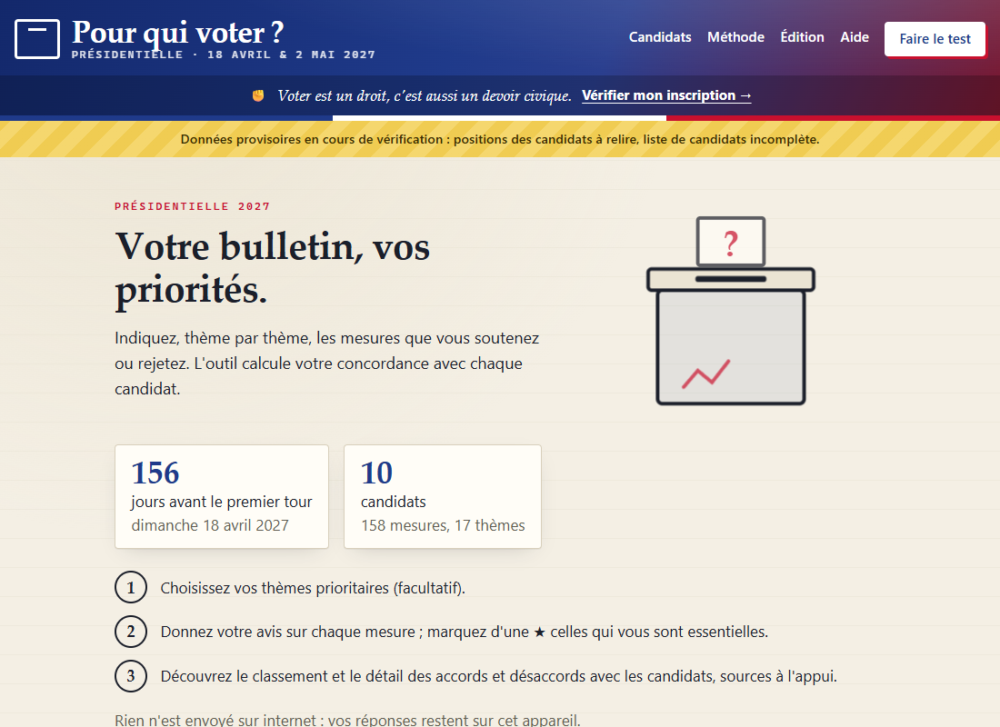
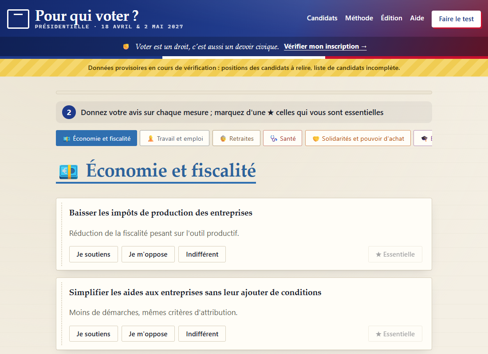
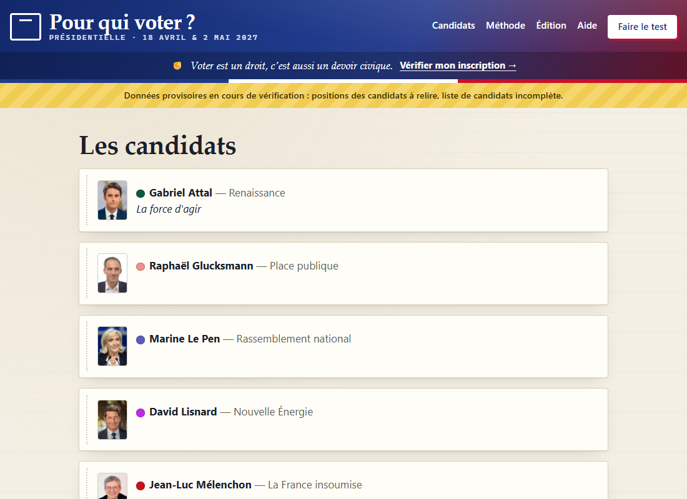
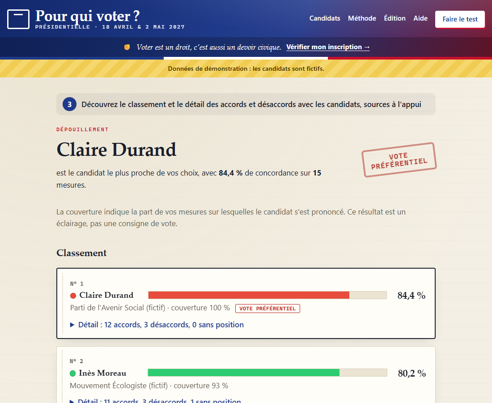
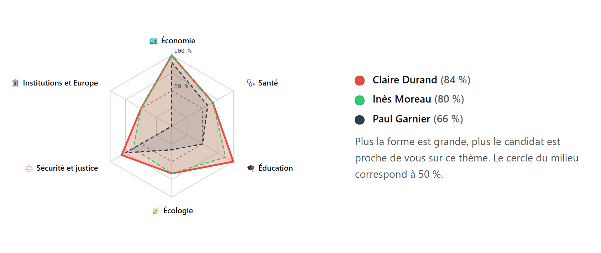
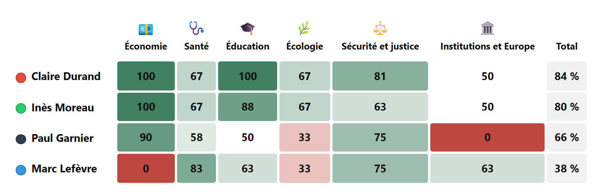

# Pour qui voter ? — French presidential election 2027

**Pour qui voter ?** ("Who should I vote for?") is a free, neutral and **offline** voting advice tool for the 2027 French presidential election. It compares your opinions on concrete policy measures with the programmes of the candidates, and explains the result with sources.

> The application itself is in French, since it is meant for French voters. This page is for developers and contributors.
> *Version française : [LISEZMOI.md](LISEZMOI.md).*



| Questionnaire | Candidates |
|---|---|
|  |  |

*Screenshots of the test pack (13 November 2026).*

## How it works

1. **Choose your priority themes** (optional): measures in these themes count twice.
2. **Give your opinion on each measure** (for / against / indifferent) and mark the ones that are essential to you with a ★ (they count three times).
3. **See the ranking** of candidates, with the details of agreements and disagreements, each backed by a link to the source (the candidate's campaign site first, then the party site, then reputable press, flagged as such).

## Results and method



*Results page shown with the demonstration pack: the candidates are fictional.*

### What the results page shows

- **The ranking** of candidates by agreement rate (0 to 100 %), with a bar in the candidate's colour. The first one is marked *Vote préférentiel* (closest to your choices).
- **Coverage** for each candidate: the share of your measures on which the candidate has a known position. A low coverage means the score rests on few elements.
- **Ties** (*Ex æquo*): candidates less than 2 points behind the first one are flagged, because the difference is not significant.
- **The detail** for each candidate: agreements, disagreements and measures without a known position, grouped by theme, each with a link to its source; plus the score theme by theme.
- **Your profile by theme**: a radar chart of the three closest candidates and a heat map of all candidates, theme by theme.
- Candidates whose positions have not been collected yet are **listed apart, not ranked**. In second-round mode, the comparison is limited to the two qualified candidates (with a link to see all first-round candidates).
- The results can be **printed or saved as PDF**, and shared with a link that contains the answers (nothing is sent anywhere).

**Profile by theme: radar chart of the three closest candidates**



**All candidates, theme by theme: heat map of agreement (%)**



*Charts as rendered in the printed / PDF results (demonstration pack, fictional candidates). Green: close to your choices; red: far; grey: neutral or no position.*

### How the score is computed

1. **Each measure earns or costs points.** Your opinion (for = +1, against = −1) is multiplied by the candidate's position (supports = +1, partly supports = +½, no position = 0, opposes = −1). Measures you marked *Indifférent* are left out.

   | Your opinion | Supports | Partly supports | No position | Opposes |
   |---|---|---|---|---|
   | For | +1 | +½ | 0 | −1 |
   | Against | −1 | −½ | 0 | +1 |

2. **What matters to you weighs more.** A measure in a priority theme counts ×2, a measure marked ★ essential counts ×3, and both combine (×6). Without these choices, every measure has weight 1.
3. **The total becomes a percentage.** The weighted sum, which ranges from −(sum of weights) to +(sum of weights), is mapped to 0–100 %:

   `score = (Σ weight × opinion × position ÷ Σ weight + 1) ÷ 2 × 100`

   100 % means agreement on everything, 50 % as many agreements as disagreements (or no known position), 0 % disagreement on everything.

**Example**: three measures, health is a priority theme. "Recruit care workers" (health, ★): for / supports, weight 2 × 3 = 6, +6 points. "Raise the minimum wage": for / partly supports, weight 1, +0.5. "Tax kerosene": against / supports, weight 1, −1. Total +5.5 out of a maximum of 8, so (5.5 + 8) ÷ 16 × 100 = **84.4 %**.

**Where positions come from**: first the candidate's official site and programme, then the party site, then reputable press. Every position comes with its source; a position taken only from the press or an interview is marked *à confirmer* (to be confirmed). The result is a guide, not a voting instruction.

The method is explained in plain French in the app (*Méthode* page) and implemented in [`assets/js/score.js`](assets/js/score.js), tested by [`tests/score.test.js`](tests/score.test.js).

## Key principles

- **Privacy by design**: no account, no server, no analytics. Your answers never leave your device (they are stored only in your browser's `localStorage`).
- **Offline**: a static single-page application opened directly from `index.html` (`file://`). A strict Content Security Policy (`connect-src 'none'`) blocks every network request; an automated test checks it.
- **Neutrality**: measures are worded neutrally, every candidate position is quoted and sourced, and positions that are inferred or come from the press are marked "to be confirmed". Candidates whose positions have not been collected yet are listed but not ranked.
- **Transparency**: data and code are open; each data update is recorded in a changelog, and a dated "lessons learned" note follows every data collection ([`docs/enseignements/`](docs/enseignements/)).
- **Modifiable and customisable**: in *Édition* mode, anyone can add, edit or delete themes (name, icon, colour, order), measures, candidates (colour, portrait, profile) and positions, directly in the browser, with no code and no server. Changes are saved on the device and flagged as local; the data can be exported (JSON pack, positions as CSV) and re-imported, with a preview of the changes, a fingerprint check and an automatic backup before anything is replaced. In the online demo, editing is a sandbox and candidates are locked.
- **Reusable**: the same tool can serve other elections by replacing all its content, for example a school or parent-representative election.

## Status

| Item | State |
|---|---|
| Application | Feature-complete (questionnaire, results, candidate pages, print/PDF, share link, edit mode, second-round mode) |
| Measure catalogue | 158 measures in 17 themes |
| Candidates | 16 candidates, with profiles (birth, education, profession from Wikipedia; free-licence portraits from Wikimedia Commons) |
| Positions | 773 **draft** positions for 15 candidates, under human review; Teddy Riner is listed but not ranked yet |
| First public data pack | Planned for 15 January 2027 |

The current data (`data/donnees.json`, version `2026.11.13-test.3`) is a **test pack**: do not use it to make a voting decision.

## Quick start

**Users**: download the ZIP archive from the [Releases](https://github.com/PatrickDarbeau/pour-qui-voter/releases) page, unzip it and double-click `index.html`. Nothing to install.

**Developers**: clone the repository and open `index.html` in a browser, or serve it locally:

```bash
python -m http.server 8765
```

Requirements for the tools and tests: Python 3.10+ (with Pillow for portraits), Node.js 18+, and Google Chrome for the headless tests.

## Repository layout

| Path | Content |
|---|---|
| `index.html`, `assets/` | The application (vanilla JavaScript, CSS, candidate portraits) |
| `data/donnees.json`, `data/donnees.js` | Installed data pack (JSON, and the same data as a script for `file://` use) |
| `data/demo/` | Demonstration pack with fictional candidates |
| `outils/` | Python tools to build, validate and package the data |
| `tests/` | Unit tests (scoring, tools) and headless browser checks (offline, print) |
| `docs/` | Developer notice, catalogue, candidate profiles, positions, lessons-learned notes |

## Development commands

| Command | Purpose |
|---|---|
| `python outils/catalogue.py` | Generates the measure catalogue (draft) |
| `python outils/candidats.py` | Generates the candidate profiles (draft) |
| `python outils/portraits.py` | Downloads and crops the candidate portraits (3:4) from Wikimedia Commons |
| `python outils/positions.py` | Builds the candidate positions (draft) from `outils/positions_<id>.py` |
| `python outils/assembler.py --installer` | Assembles the test pack and installs it in `data/` |
| `python outils/valider.py --publier` | Validates `data/donnees.json` and generates `data/donnees.js` |
| `python outils/comparer.py` | Writes a comparative analysis (coverage, proximity, divisive and consensus measures) |
| `python outils/questionnaire.py` | Generates the reply questionnaire for candidates (CSV) and the list of measures by theme, from the installed catalogue |
| `python outils/maj.py candidats` · `collecter` · `diff A B` · `publier --version YYYY.MM.DD` | Data update workflow (see the developer notice) |
| `python outils/demo.py` | Regenerates the demonstration pack |
| `python outils/paquet.py` | Builds the user ZIP archive in `dist/` |
| `node tests/score.test.js` | Scoring tests |
| `python -m unittest tests/test_outils.py` | Tool tests (validator, catalogue, profiles, positions) |
| `node tests/hors_ligne.mjs` | Opens the packaged app via `file://` in headless Chrome and checks that no network request is made |
| `node tests/pdf.mjs` | Renders the results page to PDF to check printing |

## Online demo

**Try it online: <https://patrickdarbeau.github.io/pour-qui-voter/>** (demonstration pack with four fictional candidates).

A demo can be published on GitHub Pages with the manual **"Démo en ligne"** workflow (*Actions* tab). In the online demo, a banner invites visitors to download the app; the edit mode works as a sandbox (changes stay in the visitor's browser), candidates are locked and pack import is disabled. To try this mode locally, add `?demo` to the URL (e.g. `http://localhost:8765/?demo`). Download links are set in [`assets/js/config.js`](assets/js/config.js).

## Documentation

- [Specifications](CAHIER_DES_CHARGES.md) (in French; work packages in §10)
- [Developer notice](docs/NOTICE_DEVELOPPEUR.md): work packages, data release schedule, update procedure and changelog (§5)
- [Lessons-learned notes](docs/enseignements/README.md) after each data collection
- [Census of candidates](docs/recensement_candidats.md) (in French): declared, presumed and withdrawn candidates, cross-checked across several sources
- [Candidate profiles and sources](docs/fiches_candidats.md)
- [Note to candidates](docs/candidats/note_aux_candidats.md) (in French): how campaigns can send their programme and answer the 158 measures, with the [reply questionnaire](docs/candidats/questionnaire_mesures.csv)

## Contributing

Found a wrong position, a missing source or a bug? Please open an [issue](https://github.com/PatrickDarbeau/pour-qui-voter/issues) with the measure, the candidate and a link to an official source. Contributions must respect the neutrality rules: official sources first, exact quotes, no aggregator or comparison sites as sources.

## Licences

- **Code**: European Union Public Licence **EUPL 1.2**, see [LICENCE](LICENCE).
- **Data** (themes, measures, candidate profiles, positions): **Creative Commons BY-SA 4.0**, see [LICENCE-DONNEES](LICENCE-DONNEES).
- **Portraits**: Wikimedia Commons, under free licences (CC0, CC BY, CC BY-SA) or reusable with attribution (European Parliament); author and licence are shown under each photo.
- Short quotes from candidates' programmes remain the property of their authors and are reproduced under the right of quotation, with their source.
- Legal notice, disclaimer and privacy: [MENTIONS-LEGALES.md](MENTIONS-LEGALES.md) (in French).
